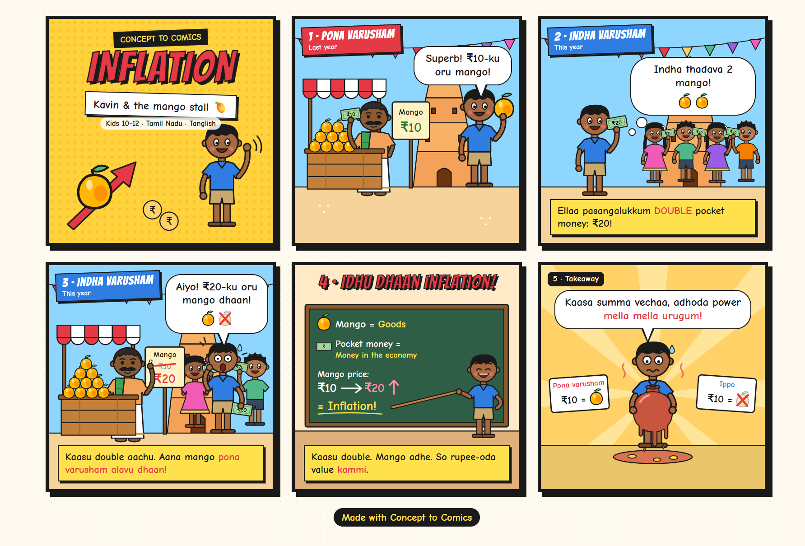

# Concept to Comics

**Turn any concept into a 3-5 panel comic that a 10-year-old can understand, using examples from your own everyday world.**

Ask "What is a JVM?", "What is inflation?" or "How does a vaccine work?" and get a short comic with characters, a story, and an analogy from *your* culture. Tea kadai, local train, lemonade stand or village market: you pick.

> 🗓️ **Weekend Project #1** by [@techie_sasikumar](https://instagram.com/techie_sasikumar). A new AI build every weekend. Follow along!

<!-- TODO: add demo GIF / sample comic image here -->
<!--  -->

---

## Why

Most "explain like I'm 5" answers are either too technical or simple but *wrong*. Concept to Comics checks three things for every concept:

1. **What** is it?
2. **Why** does it happen? (the part most explanations skip)
3. **So what?** Why should I care?

Then it picks an analogy from your world, checks the analogy doesn't teach anything wrong, and draws it as a comic.

## What you get

Every comic gives you, short and light:
- 📜 A comic script (3-5 panels)
- 🗺️ A mapping table: what in the comic = what in real life
- ⚠️ "Where this analogy breaks", one honest line

🎨 **See it drawn, free:** copy the script and paste it into the **[Comic Viewer](https://techiesasikumar.github.io/concept-to-comics/viewer/)**. You get a drawn comic with characters, speech bubbles and a cheat sheet. Print it, save it as a PDF, or copy a share link. No login, and it uses none of your AI chat limit.

Want more? Just reply to the AI:
- **draw** → a custom-drawn HTML comic page made by the AI (in AIs that can make HTML/artifacts)
- **prompts** → 🖼️ image prompts for ChatGPT, Gemini (Nano Banana), Midjourney and others

💡 The AI-drawn page is the "heavy" part, so it's only made when you ask. The free viewer is the light way to see your comic.

## How to use

### Option 1: Any chat AI (ChatGPT, Gemini, Claude, etc.). No setup needed
1. Open [`SKILL.md`](SKILL.md) and copy everything.
2. Paste it as your first message.
3. Answer 3 quick questions (audience, culture, language). One line is fine, e.g. `1, 1, Tanglish`.
4. Ask any concept.
5. Paste the script into the [Comic Viewer](https://techiesasikumar.github.io/concept-to-comics/viewer/) to see it drawn. Done!

### Option 2: As an Agent Skill (Claude, Claude Code, Codex, Cursor, Copilot and other SKILL.md-compatible tools)
Copy the whole `concept-to-comics` folder into your tool's skills folder. For Claude Code:

```bash
git clone https://github.com/techiesasikumar/concept-to-comics.git ~/.claude/skills/concept-to-comics
```

In the Claude app you can upload the folder as a zip from the skills settings. For other tools, check their docs for where skills live.

Then just ask: *"Explain recursion as a comic for my 10-year-old"*.

## Audiences & cultures

Built-in audiences: school kids, college students, working adults (non-tech), elders, tech people.

Built-in worlds: Tamil Nadu, North India, USA, UK, global, or describe your own in one line.

## Contribute a culture pack 🌍

Want analogies from Kerala, Lagos, Manila, São Paulo or your village? Add a file to [`cultures/`](cultures/) using [`cultures/_template.md`](cultures/_template.md) and open a pull request.

## Examples

See [`examples/`](examples/). Each example has a `script.md` you can paste straight into the [Comic Viewer](https://techiesasikumar.github.io/concept-to-comics/viewer/).

## License

MIT. Use it, remix it, teach with it.

---

Made with ❤️ as Weekend Project #1 by **@techie_sasikumar**. Want to build your own AI app? Join **Build your first app with AI**. <!-- TODO: add link -->
