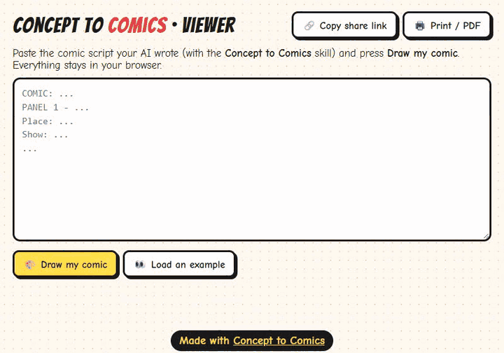

# Concept to Comics

**Turn any concept into a 3-5 panel comic that a 10-year-old can understand, using examples from your own everyday world.**

Ask "What is a JVM?", "What is inflation?" or "How do plants make food?" and get a short comic with characters, a story, and an analogy from *your* culture. Tea kadai, local train, lemonade stand or village market: you pick.

## ▶️ Try it now in one click (no setup)

1. **Gemini, ChatGPT, Claude or any AI chat:** copy [SKILL.md](SKILL.md) and paste it as your first message.
2. **Ask any concept**, like *"What is inflation?"*
3. **See it drawn:** paste the AI's script into the free [Comic Viewer](https://techiesasikumar.github.io/concept-to-comics/viewer/). No login.



> 🗓️ **Weekend Project #1** by [@techie_sasikumar](https://instagram.com/techie_sasikumar). A new AI build every weekend. Follow along!

---

## How it works (in 1 minute)

There are only two pieces:

| Piece | What it is | What it does |
|---|---|---|
| 📜 [`SKILL.md`](SKILL.md) | An instruction sheet for AI | Teaches **your own AI chat** (ChatGPT, Gemini, Claude...) how to explain any concept as a comic script |
| 🎨 [Comic Viewer](https://techiesasikumar.github.io/concept-to-comics/viewer/) | A free web page | Turns that script into a drawn comic, right in your browser |

```
 1. ONE TIME               2. EACH CONCEPT              3. SEE IT DRAWN
 Paste SKILL.md into   →   Ask: "What is inflation?" →  Paste the script into
 your AI chat. Answer      Your AI writes a short       the Comic Viewer and
 3 quick questions.        comic script.                press "Draw my comic".
```

That's it. Want another concept? Just ask in the same chat, and paste the new script into the viewer.

---

## Step by step

### 1. Set up your AI (once)
1. Open [`SKILL.md`](SKILL.md), click the **copy** button (top right of the file), and copy everything.
2. Open **ChatGPT, Gemini, Claude** or any AI chat, and paste it as your **first message**.
3. The AI asks 3 quick questions: **who** is it for, **whose world** should the examples come from, and **which language**. You can answer in one line, e.g. `1, 1, Tanglish`.

💡 Tip: in ChatGPT you can save SKILL.md as a **Custom GPT**, and in Gemini as a **Gem**, so you never paste it again.

### 2. Ask any concept
Type things like *"What is inflation?"*, *"How does a vaccine work?"* or *"Explain recursion"*.

The AI writes:
- 📜 a comic script (3-5 panels)
- 🗺️ a mapping table: what in the comic = what in real life
- ⚠️ "Where this analogy breaks": one honest line, so no wrong lessons

### 3. See it drawn (free)
1. Copy the AI's script (everything from `COMIC:` to `Where it breaks:`).
2. Open the **[Comic Viewer](https://techiesasikumar.github.io/concept-to-comics/viewer/)** and paste it in the box.
3. Press **🎨 Draw my comic**.

You get a title card, the panels with characters and speech bubbles, and a cheat sheet. Then you can:
- 🔗 **Copy share link**: send the comic to anyone. The whole comic lives inside the link.
- 🖨️ **Print / PDF**: print it or save it as a PDF.
- 📸 **Screenshot** each square panel for an Instagram or LinkedIn carousel.
- ✏️ **Edit script**: fix a word, and draw again.

### Change anything, anytime
Just tell your AI: *"new concept: ..."*, *"make it for elders"*, *"switch to Tamil"*, *"use a cricket example"*. It only redoes what changed.

### Want more? Reply to your AI with
- **prompts** → 🖼️ image prompts for ChatGPT images, Gemini (Nano Banana), Midjourney and others
- **draw** → the AI draws a custom HTML comic page itself (in AIs that can make HTML/artifacts). Prettier, but it uses about 10x more of your chat limit, so it's only made when you ask.

---

## Is it free? Who pays for the AI?

- **The Comic Viewer is 100% free.** The "Draw my comic" button is not AI. It's simple drawing code that runs in your own browser. No login, no account, no AI tokens, and your script is never sent to any server.
- **The script is written by your own AI chat**, on your own free or paid plan. One comic script is small (about the size of a normal chat answer), so free plans can make many comics.
- **This project costs its maker nothing to run**: the viewer is hosted free on GitHub Pages, and there's no server or API key behind it.

---

## Good to know (limits)

- The viewer draws **simple, ready-made scenes** (market, temple festival, kitchen, home, classroom, lab, park, farm, office, shop, beach, space, inside the body) and objects as **emoji**. For a fully custom picture, reply **draw** or **prompts** to your AI.
- Emoji look a little different on Windows, iPhone and Android.
- The quality of the explanation depends on your AI. The skill makes it check facts and say "where this analogy breaks", but always use your judgment for important topics.

---

## Using it as an Agent Skill (for developers)

Works with Claude, Claude Code, Codex, Cursor, Copilot and other SKILL.md-compatible tools. Copy the whole `concept-to-comics` folder into your tool's skills folder. For Claude Code:

```bash
git clone https://github.com/techiesasikumar/concept-to-comics.git ~/.claude/skills/concept-to-comics
```

In the Claude app you can upload the folder as a zip from the skills settings. For other tools, check their docs for where skills live.

Then just ask: *"Explain recursion as a comic for my 10-year-old"*.

---

## Why this exists

Most "explain like I'm 5" answers are either too technical or simple but *wrong*. Concept to Comics checks three things for every concept:

1. **What** is it?
2. **Why** does it happen? (the part most explanations skip)
3. **So what?** Why should I care?

Then it picks an analogy from your world, checks that every part of the analogy is true, and makes sure the story has no gaps a child could misread.

## Audiences & cultures

Built-in audiences: school kids, college students, working adults (non-tech), elders, tech people.

Built-in worlds: Tamil Nadu, North India, USA, UK, global, or describe your own in one line.

## Examples

See [`examples/`](examples/). Each example has a `script.md` you can paste straight into the [Comic Viewer](https://techiesasikumar.github.io/concept-to-comics/viewer/).

## What's in this repo

```
SKILL.md            the skill: paste it into any AI chat
viewer/index.html   the free Comic Viewer (hosted on GitHub Pages)
examples/           finished sample comics
cultures/           culture packs (add yours!)
```

## Contribute a culture pack 🌍

Want analogies from Kerala, Lagos, Manila, São Paulo or your village? Add a file to [`cultures/`](cultures/) using [`cultures/_template.md`](cultures/_template.md) and open a pull request.

## License

MIT. Use it, remix it, teach with it.

---

Made with ❤️ as Weekend Project #1 by [@techie_sasikumar](https://instagram.com/techie_sasikumar).

🚀 **Build your first app with AI** (live session) - coming soon! DM 'BUILD' on Instagram [@techie_sasikumar](https://instagram.com/techie_sasikumar) to join the waitlist.
